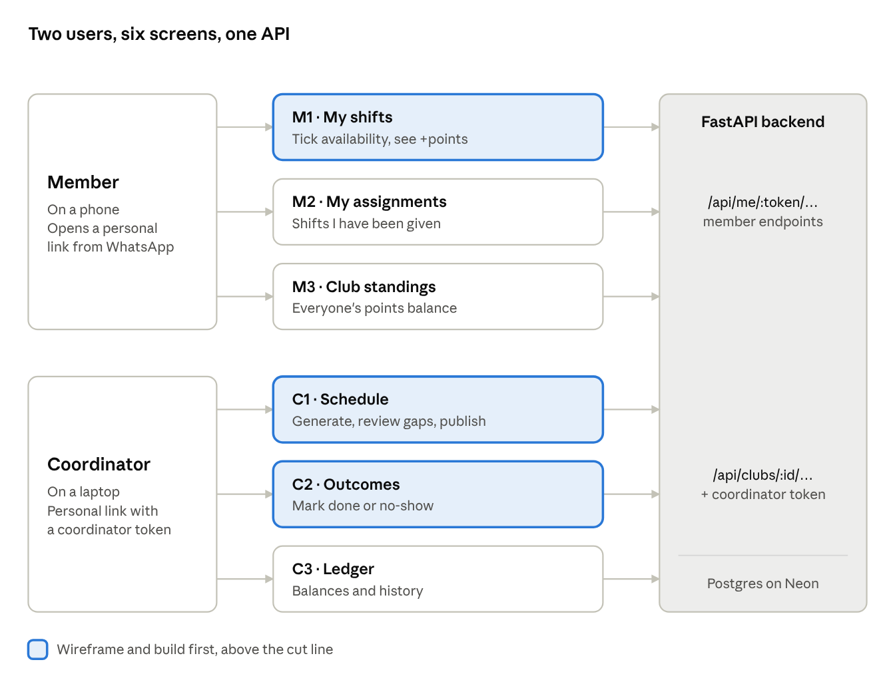
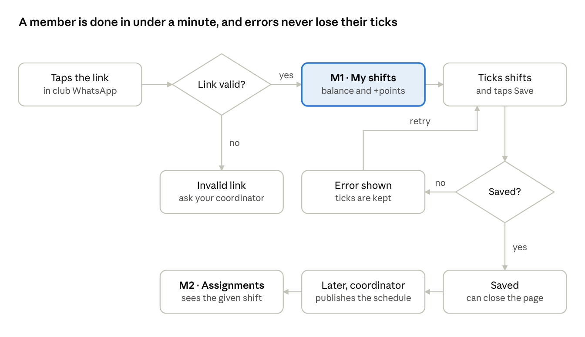
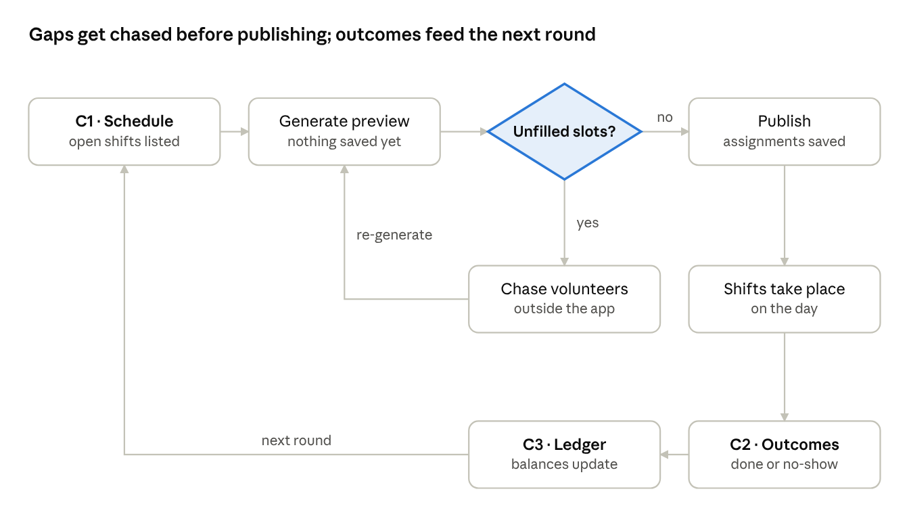

# Club Shift Scheduler: Frontend Wireframe Plan

Oct 23, 2026 · @Shawn

> Written before any Vue code. The wireframes themselves were postponed in favour of a working frontend first; the flows and screen checklist below shaped the build directly.

Six screens across two users: three for the member on a phone, three for the coordinator on a laptop, wireframed in greyscale before any Vue code.

## Users and screens

The two users never share a screen: members only ever see their own link's three screens, and coordinators work from a separate link that carries the coordinator token. Both sides read the same ledger, which is what makes the fairness visible to everyone.

## Member flow

The member's whole job is one screen and one button. The two error paths matter most on a phone: a dead link must say who to ask, and a failed save must keep the ticks so nobody has to start again on a bad connection.

## Coordinator flow

The unfilled-slots check is the coordinator's real question, so C1 is designed around it. Publishing with known gaps is allowed; the chase happens in WhatsApp, outside the app, and a fresh preview picks up the new volunteers.

## Screen checklist

Each wireframe covers its happy path plus every state in its row; a screen without its states drawn is not done.

| # | Screen | Who, device | Must show | States to draw | API |
| --- | --- | --- | --- | --- | --- |
| M1 | **My shifts** | Member, phone | Name and club; own points balance with one line on how points work; upcoming shifts grouped by date, each with type, time and "+N points"; one tick per shift; one Save button | Loading; invalid link; no upcoming shifts; saving; saved; save failed | `GET /api/me/{token}/shifts`, `PUT /api/me/{token}/availability` |
| M2 | **My assignments** | Member, phone | Shifts the member has been given, with date and time; empty until a schedule is published | Nothing assigned yet; assigned | Needs a backend addition (gaps below) |
| M3 | **Club standings** | Member, phone | Everyone's balance, own row highlighted; recent history lines | Empty season (all zero) | `GET /api/clubs/{id}/ledger` |
| C1 | **Schedule** | Coordinator, laptop | Open shifts; Generate button; preview grouped by date and shift with each assigned member and their balance; **unfilled slots as the most prominent element**; Publish button, visually heavier and separate from Generate | Nothing to schedule; generating; preview with gaps; preview with no gaps; publishing; published | `.../schedule/generate`, `.../schedule/publish`, `GET .../shifts` |
| C2 | **Outcomes** | Coordinator, laptop | Published assignments past their date; Done and No-show per row; points change shown on each button | Nothing to record; recorded (locked row); conflict (already recorded) | `GET .../assignments`, `PATCH /api/assignments/{id}` |
| C3 | **Ledger** | Coordinator, laptop | Balances table; history newest first with the reason text | Empty season | `GET .../ledger` |

**Below the cut line this week:** a setup screen for creating clubs, members, shift types and shifts. The seed script covers the demo; draw it only if time is left over.

**Shared across every screen:** a header with the club name; one error pattern (message plus retry); one empty-state pattern (a sentence plus the next action). Drawing these once as components saves redrawing them six times.

## Backend gaps the wireframes exposed

Designing the member screens showed that a member can't see three things the product promises; all three are small backend additions, about an hour together.

| Gap | Why it matters | Fix |
| --- | --- | --- |
| A member can't see who they are or their own balance | M1 must show name, club and balance, but the member only holds a token, not the club id | New `GET /api/me/{token}`: name, club id and name, balance |
| A member can't see their assignments | The README promises "everyone can see who's doing what", but no member endpoint returns assignments | Add `assigned: bool` to each item from `GET /api/me/{token}/shifts` |
| Changing availability after a schedule is published | A member could untick a shift they were already given, and nothing would warn anyone | V1: lock assigned shifts on M1 and say why; swaps stay a v2 feature |

This section is worth keeping for the case study: the gaps only became visible once the screens were designed around real users, which is the argument for designing before building.

## Wireframing order and handover

Wireframe in the order the screens get built, timeboxed to 45 minutes; anything past the cut line waits for the weekend.

1. **Shared patterns:** header, error, empty state (5 minutes)
2. **M1 My shifts,** with all six states (15 minutes)
3. **C1 Schedule,** generate, preview with gaps, published (15 minutes)
4. **C2 Outcomes** (10 minutes)
5. *Cut line*
6. M2 My assignments, M3 Club standings, C3 Ledger
7. Setup screen

**Rules for this pass:** greyscale boxes and real copy, no colour, no icons, no pixel polish. Real copy matters most: "+3 points" next to a shift, the unfilled-slot message, the button labels. Wording is design at this stage.

**Frame sizes:** phone 390 × 844, laptop 1440 × 900.

**Already decided, so no need to wireframe options:** coordinators get a personal link like members (no login screen); the member side has no navigation beyond M1, M2 and M3 tabs.
