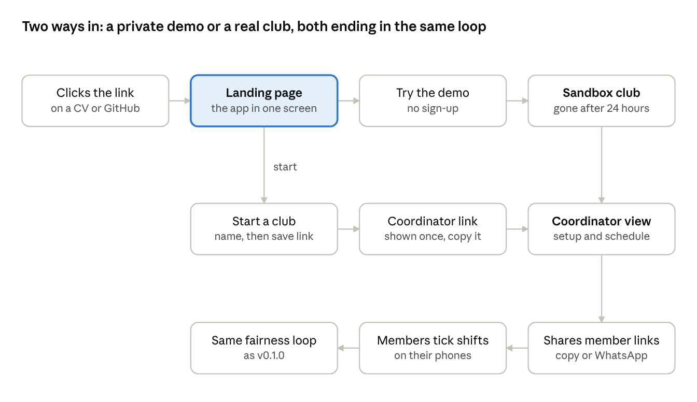

# Club Shift Scheduler: v0.2.0 Plan

Oct 27, 2026 · @Shawn

v0.2.0 turns a working demo into something a stranger can try from the link alone, and a real club could set up without the seed script. Visual design stays out of scope until the functionality is in place.

## Goal

Someone clicking the Render link with no context can understand the app and try the whole fairness loop in under five minutes, and a coordinator can set up a real club without touching code.

### Definition of done

- [ ] The root URL shows a landing page that explains the app in one screen, never "Page not found"
- [ ] "Try the demo" gives every visitor their own sandbox club, so one visitor can't spoil the demo for the next
- [ ] A coordinator can create a club, add members, shift types and shifts, and copy each member's link, all in the app
- [ ] Slots left open after publishing can be filled by generating again
- [ ] Members can see their assignments and the club standings; coordinators can see the ledger
- [ ] Database changes go through migrations; no more wiping Neon to change a table
- [ ] Every new endpoint has a test; CI stays green
- [ ] Tagged `v0.2.0` with release notes

**Design is deliberately out of scope.** The screens stay plain until the whole structure exists; the design pass follows in v0.3.0, when it's clear how everything fits together.

## Findings from the v0.1.0 user test

The first test found no bugs, but four places where the member page doesn't explain itself; all four fit into session 10, which builds the member's assignments view anyway.

| Finding | What the tester did or said | Change in v0.2.0 |
| --- | --- | --- |
| Assignments look like orders | Assumed the coordinator picked her by hand | Each assigned shift says why: "You said you could, and you have the fewest points" |
| Assigned shifts show no points | Couldn't see what the referee shift was worth | Show points on assigned shifts too |
| Outcomes are invisible | "I don't see anything different this time around" after her shift was marked done | Show done or no-show, the points added and the new balance |
| Saved ticks read as the app's choice | Read pre-ticked shifts as "automatically selected" | Label ticks as her saved answers; a new member starts with none |

**Open question for the next testers:** the top-weighted shift was still "the last one that I would choose". If points don't motivate, the priority rule is the real fairness mechanism, and the copy should say so.

## First visit

The landing page is the only new decision point: everything to its right reuses screens from v0.1.0 or adds the Setup tab. The demo path matters most for applications, because it's what a recruiter clicking the link will actually take.

## Scope

Six features: the first two fix the broken first impression, the next two make the app usable by a real club. The session plan below sets the build order, with the backend tidy-up done early.

| # | Feature | Backend | Frontend | Why it's in |
| --- | --- | --- | --- | --- |
| 1 | **Landing page** at `/` | None | One screen: the problem in a sentence, the fairness loop in three steps, "Try the demo", "Start a club", link to GitHub | The Render link currently opens on "Page not found" |
| 2 | **Demo sandbox** | `POST /api/demo` creates a fresh seeded club per visitor and returns its coordinator link and member links; clubs flagged as demo are deleted after 24 hours | Demo coordinator view gets a "Member links" panel to open members in a new tab or on a phone | A shared demo breaks as soon as one visitor publishes; a sandbox per visitor never does |
| 3 | **Club setup** | Already exists: create club, members, shift types, shifts. Add edit and delete for members and shifts | "Start a club" form, then a coordinator **Setup** tab: members list with copy-link and share-to-WhatsApp, shift types, shifts | Without it, nobody can use the app without the seed script |
| 4 | **Refill open slots** | A shift counts as open while assigned people are fewer than its slots; the solver fills only the remaining slots | Schedule screen shows partly filled shifts as open, with how many are left | The known gap from v0.1.0, and the copy on C1 already admits it |
| 5 | **Remaining screens** | Nothing new | M2 My assignments and M3 Club standings as tabs on the member page; C3 Ledger tab for coordinators | Planned in v0.1.0, below the cut line |
| 6 | **Tidy the backend** | Split `main.py` into routers (clubs, members, schedule, outcomes, demo); shared helper for create endpoints | None | `main.py` is long enough that every feature above gets slower without this, so it's done before them |

**Order matters for one reason:** the sandbox in feature 2 reuses `seed.py` as a function, and feature 3 reuses the existing create endpoints, so most of v0.2.0 is new screens on top of backend code that already exists.

## First: database migrations

v0.2.0 can't start without migrations, because the first feature already changes a table.

- **The problem:** v0.1.0 creates tables on startup (decision 6). That only creates *missing* tables; it never adds a column to an existing one. The demo sandbox needs two new columns on `club` (whether it's a demo, and when it was created), so on Neon the change would silently not happen and the app would crash.
- **The fix:** Alembic, the standard migration tool for SQLAlchemy. Each schema change becomes a small, versioned script in the repo, applied with one command locally and automatically on every Render deploy.
- **Why now:** every later feature that touches the schema needs it anyway, and it closes the v2 item the v0.1.0 decision log promised.

Recorded as decision 11 in [plan.md](plan.md).

## Session plan

Twelve sessions of 60 to 90 minutes, each ending in a merged pull request, so an interruption never leaves half-finished work behind.

| # | Session | Ends with | Learn |
| --- | --- | --- | --- |
| 0 | Close v0.1.0: test findings in the journal, tag `v0.1.0`, release notes | Release page | |
| 1 | Alembic: install, first migration matching today's tables, run on deploy | Same app, schema now versioned | Migrations |
| 2 | Split `main.py` into routers; shared create helper | Same API, all tests green | Python packages and imports |
| 3 | Landing page at `/` | No more "Page not found" on the live link | |
| 4 | Demo backend: migration for the two club columns, `seed` as a function, `POST /api/demo`, cleanup after 24 hours, tests | Sandbox via `/docs` | Reusing code, cascading deletes by hand |
| 5 | Demo frontend: "Try the demo" button, member links panel | A stranger can try the full loop | |
| 6 | "Start a club" form and Setup tab: members, with copy-link and WhatsApp share | Real clubs can be created | |
| 7 | Setup tab: shift types and shifts; edit and delete endpoints with tests | Setup without the seed | REST updates and deletes |
| 8 | Refill open slots: backend change and tests | Gaps fillable after publishing | Changing tested logic safely |
| 9 | Refill open slots on the schedule screen | Known limitation removed from the README | |
| 10 | M2 My assignments, M3 Club standings, plus the four user-test findings | Member side complete | |
| 11 | C3 Ledger, README update, tag `v0.2.0` | Release page | |

**If time runs short, cut from the bottom:** the M2, M3 and C3 screens move to v0.3.0, and v0.2.0 gets tagged without them. Sessions 1 to 5 are the core, because they fix what a visitor sees first.

## Not in v0.2.0

- Visual design and the Figma MCP pass (v0.3.0, once the structure is complete)
- Accounts and passwords, email or push notifications
- Shift swaps between members
- CP-SAT solver (v0.3.0, alongside the design pass)
- Dutch translation

## Risks

| Risk | Response |
| --- | --- |
| Sessions keep getting pushed by job hunting and family | Each session is self-contained and merged; a two-week gap costs nothing but time |
| Strangers abuse the demo endpoint to fill the database | Delete demo clubs after 24 hours, and cap the number of live demo clubs; Neon's free tier holds 1 GB |
| A coordinator loses their link after creating a club | Show the link once with a clear "save this" step and a copy button; recovery by email stays out of scope |
| Migrations go wrong on Neon | Test each migration locally first; demo data can always be reseeded |

## Open questions

- **Demo links on a phone:** open member links on the same device in a new tab, or show a QR code to scan with a phone? The QR code is nicer for a demo but adds a library.
- **Shifts in bulk:** should "repeat this shift weekly for N weeks" be in session 7, or wait? It's the first thing a real coordinator would ask for.
