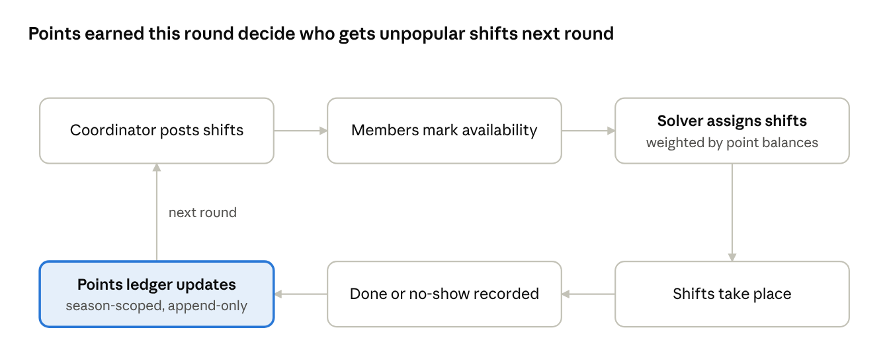

# Club Shift Scheduler: Project Plan

Oct 18, 2026 · @Shawn & Claude

> Snapshot of the original v0.1.0 plan, updated with the decision log as of v0.2.0 work. The plan was written before building; the dates and day-by-day table show the original intent, not what happened. For what happened, see [journal.md](journal.md).

## Problem

Dutch amateur sports clubs run on mandatory volunteer duties, and coordinators fill those rosters by hand, so the same reliable members carry the load and the unpopular slots stay empty until the last minute.

- **Who has it:** the volunteer coordinator, and every member who owes duties: bar shifts, refereeing youth matches, driving to away games, setting up fields.
- **How it works today (assumption to validate):** a spreadsheet plus WhatsApp chasing. Nobody can see whether the load is fair, so it usually isn't.
- **What we build:** the coordinator posts shifts, members mark availability through a personal link, a solver assigns shifts fairly, and a points ledger makes fairness visible and rewards people who take unpopular shifts.
- **Testers:** me as coordinator; seeded fake members as volunteers.
- **Working name:** #tbd

## Definition of done (Friday 23 October)

By Friday evening there is a live URL where the whole fairness loop works end to end.

- [ ] A coordinator creates a club, shift types (each with an unpopularity weight) and shifts for a period
- [ ] Each member gets a personal link and marks every shift available, preferred or unavailable
- [ ] The coordinator generates a schedule; every hard rule holds; unfillable slots are reported, never hidden
- [ ] The coordinator marks shifts done or no-show, and the points ledger updates
- [ ] The next generated schedule uses the new point balances
- [ ] The solver has automated tests, and they run on every push
- [ ] The README explains the problem, how to run it, and the key decisions

### Not this week

- User accounts and passwords (personal links instead)
- Email, SMS or push notifications
- Shift swapping between members (the strongest v2 feature; park it)
- Badges, leaderboards, streaks
- Multiple clubs or extra roles
- Dutch translation (English first, all UI text in one file so translation is cheap later)
- A native mobile app (responsive web only)

Any new idea during the week goes into `docs/v2-ideas.md`, not into the code.

## Systems view

The product is a feedback loop, not a form: fairness only works if points earned this round change who gets which shift next round.

Read it clockwise from the top left. The upward arrow is what most rostering spreadsheets lack: what happened this round changes the next one.

Every loop that rewards people also invites gaming. These are the failure modes the design has to absorb:

| Failure mode | What happens | V1 response |
| --- | --- | --- |
| Dodging | A member marks everything unavailable to avoid work | Coordinator sees how many shifts each member offered; a minimum-availability rule is a v2 option |
| Hoarding | Someone banks points early, then disappears | Points count per season, not forever |
| No-shows | Assigned, but never turns up | No-show costs points; the coordinator records it |
| Distrust | Members can't see why they got a shift and reject the system | Each assignment can show a one-line reason (stretch goal) |
| Overrides | The coordinator changes the solver's result by hand | Allowed; the ledger keeps the history either way |

This table is case-study gold: it shows you designed for human behaviour, not just for data.

## Domain model

Seven tables carry the whole product; points are never stored as a number on a member, only as ledger entries that add up to a balance.

| Entity | Key fields | Notes |
| --- | --- | --- |
| Club | name, season start, season end | One club in v1 |
| Member | name, access token | The token is the personal link; no password |
| ShiftType | name, unpopularity weight (1 to 3), default slots | "Bar, Saturday 07:00" might be weight 3 |
| Shift | shift type, start, end, slots needed | One concrete occurrence of a type |
| Availability | member, shift, status (available, preferred, unavailable) | No answer counts as unavailable |
| Assignment | member, shift, status (assigned, done, no-show) | One row per filled slot |
| PointsEntry | member, change, reason, created at | Append-only; balance = sum of changes |

**Why a ledger instead of a points column:** every balance can be explained line by line, mistakes are fixed by adding a correcting entry instead of editing history, and it is the same pattern banks use. That is a strong interview answer.

## Scheduling rules

Hard rules never break; soft rules are traded off by weight; when the hard rules leave a slot impossible to fill, the solver leaves it empty and says why instead of failing.

### Hard rules

1. Only assign members who marked the shift available or preferred
2. Nobody works two overlapping shifts
3. Nobody exceeds the maximum shifts per period (setting, default 2)
4. Never assign more people than a shift's slots

### Soft rules, most important first

1. Fill as many slots as possible (a large penalty per empty slot)
2. Spread the load evenly across members
3. Give unpopular shifts to members with the lowest points balance
4. Honour "preferred" where possible

### Points

- Shift done: plus the shift type's weight
- No-show: minus the shift type's weight
- Balances reset each season

### How we build the solver

Tuesday starts with a greedy version in plain Python (sort shifts by difficulty, give each to the best available member). Then the same rules in OR-Tools CP-SAT. Both run against the same test scenarios, which gives you a working fallback, a test suite, and a before/after comparison for the case study.

## Architecture and stack

One deployable service: FastAPI answers `/api/...` and serves the built Vue app for every other URL, so there is one thing to deploy and no cross-origin setup.

| Layer | Choice | Why |
| --- | --- | --- |
| Frontend | Vue 3, Vite, TypeScript, Vue Router | Your comfort zone, so the learning budget goes to Python |
| API | FastAPI with Pydantic | Small, explicit, typed; interactive docs at `/docs` for free |
| Database layer | SQLModel; SQLite locally, Postgres in production | Same model classes in both places |
| Solver | Google OR-Tools (CP-SAT) | Free, industrial-grade, first-class Python support |
| Tests | pytest | Solver tested without the web layer |
| Python tooling | uv (environments, packages), Ruff (lint, format) | Fast, current standard |
| Hosting | Render free web service, Neon free Postgres | Verify current free limits on Thursday; Render free instances sleep when idle |
| CI | GitHub Actions | Runs tests on every push |

**Deliberate shortcut:** tables are created on startup, no migration tool in v1. If the schema changes, the demo database is reset. Alembic is a v2 task, and the case study says so.

## API sketch

Ten endpoints cover the definition of done; the coordinator and each member are identified by a secret token in their link.

| Method | Path | Used by | Purpose |
| --- | --- | --- | --- |
| POST | `/api/clubs` | Coordinator | Create a club; returns the coordinator token |
| POST | `/api/clubs/{club_id}/members` | Coordinator | Add a member; returns their personal link |
| POST | `/api/clubs/{club_id}/shift-types` | Coordinator | Define a shift type and its weight |
| POST | `/api/clubs/{club_id}/shifts` | Coordinator | Add shifts for the period |
| GET | `/api/me/{token}/shifts` | Member | Shifts plus the member's own availability |
| PUT | `/api/me/{token}/availability` | Member | Save availability |
| POST | `/api/clubs/{club_id}/schedule/generate` | Coordinator | Run the solver; returns a proposal, saves nothing |
| POST | `/api/clubs/{club_id}/schedule/publish` | Coordinator | Save the proposal as assignments |
| PATCH | `/api/assignments/{assignment_id}` | Coordinator | Mark done or no-show; writes a ledger entry |
| GET | `/api/clubs/{club_id}/ledger` | Both | Balances and history |

**Known trade-off:** anyone holding a link has that access. Fine for a demo, stated openly in the README. Generate and publish are separate on purpose, so the coordinator reviews before anything is final.

## Day by day

The riskiest work goes first: a live URL on Monday and the solver on Tuesday, so Thursday and Friday are wiring and polish, not discovery.

| Day | Build | Python you learn | Done when |
| --- | --- | --- | --- |
| Sun 18 (tonight) | Installs, repo, this plan in `docs/` | Environments with uv | Repo on GitHub with README and plan |
| Mon 19 | FastAPI skeleton, models, SQLite, create club/member/shift endpoints; hello-world deployed | Types, functions, modules, classes, Pydantic models, using decorators | `/docs` works locally and a live URL answers |
| Tue 20 | Solver as a standalone module: greedy, then CP-SAT; pytest scenarios; GitHub Actions | Lists, dicts, comprehensions, dataclasses, pytest fixtures, reading library docs | 4 scenarios green in CI, including an impossible one |
| Wed 21 | Solver behind the API, member links, ledger; Vue coordinator screens | Relationships in SQL, FastAPI dependencies, error handling | Coordinator generates a schedule from the UI |
| Thu 22 | Vue member page, done/no-show, balances; Postgres in production; full deploy | Configuration and environment variables | Full loop works on the live URL |
| Fri 23 | Real run with a first tester, fix the top 3 issues, demo data, README, screenshots | Refactoring, logging | Every box in the definition of done ticked |

### Daily rhythm (5 to 7 hours)

1. Short explanation of the concepts before the code
2. Code arrives with explanations, each part marked boilerplate or must-understand; you run it, break it, and can explain the must-understand parts
3. At each milestone: journal line, screenshot, commit, push

### Cut list, in this order, if a day overruns

1. Reason text per assignment
2. "Preferred" status (keep available/unavailable only)
3. Greedy versus CP-SAT comparison write-up
4. Visual polish

Never cut: the deploy, the solver tests, the ledger. Those three are the portfolio.

## Git workflow

The commit history is part of the portfolio, so it should read like a story of small, deliberate steps.

- **One public repo** from day one, with `backend/`, `frontend/` and `docs/` folders
- **`main` is always deployable;** each feature gets a short branch (`feat/solver-greedy`) merged through a pull request to yourself, so the history shows reviewable units
- **Conventional commit messages:** `feat:`, `fix:`, `test:`, `docs:`, `chore:`
- **Commit small and often;** push at least at the end of every day
- **No secrets in git:** a `.gitignore` for Python, Node and `.env` before the first real commit; the database URL lives in Render's environment settings
- **Tag `v0.1.0`** on Friday when the definition of done is met

## Risks

The two risks most likely to sink the week are scope creep and a late first deploy; both are handled by structure, not willpower.

| Risk | Likelihood | Impact | Response |
| --- | --- | --- | --- |
| Scope creep (gamification ideas, swaps) | High | High | Non-goals list; new ideas go to `docs/v2-ideas.md` |
| Home distractions cut hours | High | Medium | Judge each day by its "done when", not by hours; use the cut list |
| Python basics slow Monday down | High | Medium | Only three endpoints on Monday; concepts explained before code |
| Deployment surprises | Medium | High | Hello-world deploy on Monday, not Thursday |
| OR-Tools learning curve | Medium | High | Greedy version first, so a working solver exists either way |
| Windows tooling friction | Medium | Medium | PowerShell plus uv; WSL only if something blocks |
| Free tier limits or cold starts | Medium | Low | Check limits Thursday; note the cold start in the README |

## Decision log

Every choice below has a rejected alternative and a reason; add a row whenever the work forces a new decision.

| # | Decision | Rejected alternative | Why |
| --- | --- | --- | --- |
| 1 | FastAPI | Django with REST framework | Less hidden convention, more Python learned per hour; Vue owns the UI anyway |
| 2 | One service serves API and Vue build | Separate frontend host | One deploy, one URL, no cross-origin setup |
| 3 | Secret personal links | Accounts with passwords | Authentication is a week on its own; trade-off stated openly |
| 4 | Append-only points ledger | Points column on member | Explainable, auditable, correctable without editing history |
| 5 | Greedy solver first, then CP-SAT | CP-SAT only | Working fallback, test baseline, comparison for the case study |
| 6 | Tables created on startup (superseded by 11) | Alembic migrations | Speed this week; migrations are a v2 task |
| 7 | No answer means unavailable | No answer means available | Never assign someone who didn't respond |
| 8 | Points reset each season | Lifetime points | Stops hoarding |
| 9 | Clubs only; each solver rule is its own pluggable function | Clubs and small business at once; one monolithic model | Clear focus this week; a business rule set (rest periods, contract hours, skills, cost) becomes a documented v2 on the same engine |
| 10 | AI-assisted build: code explained and reviewed, marked as boilerplate or must-understand | Writing every line by hand; using AI without stating it | A working, deployed product within the week, while still being able to explain every important line; stated openly in the README and case study |
| 11 | Schema changes through Alembic migrations, run on every deploy; CI checks models and migrations agree | Tables created on startup (decision 6) | v0.2.0 changes existing tables, which create-on-startup can't do; every schema change is now versioned in the repo |
| 12 | Times stored timezone-aware; the API requires an offset on input and returns UTC; the browser shows Amsterdam time through one formatting function | Plain local times; formatting wherever a time is shown | SQLite and Postgres treat times differently, and the clock change falls between the seeded Saturdays; round-trip and daylight-saving tests guard it |

## Case study capture

Write the case study while building, not after: five short journal entries beat one reconstructed story.

- `docs/journal.md`, one entry per day: what you built, one decision and why, one thing you got wrong, one screenshot
- A "before" image: a messy mock WhatsApp thread or spreadsheet roster that shows the problem
- The greedy versus CP-SAT result on the same scenario: how evenly each one spread the load

## Sunday's checklist

Status > [COMPLETED]

- [x] GitHub account with two-factor authentication
- [x] Git for Windows; set your name and email with `git config --global`
- [x] Python 3.12 or newer from python.org (tick "Add python.exe to PATH")
- [x] uv (Python environments and packages)
- [x] Node.js LTS
- [x] VS Code with the Python, Vue (Official) and Ruff extensions
- [x] Create the repo, clone it, add a README with the problem statement from this doc
- [x] Copy this plan into `docs/plan.md`; commit `docs: add project plan`; push
- [x] Run `git --version`, `python --version`, `uv --version`, `node --version` and send me the output
